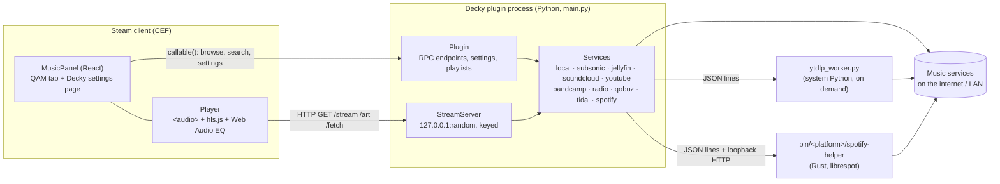
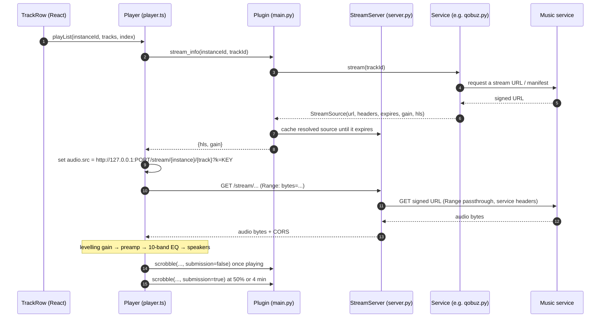
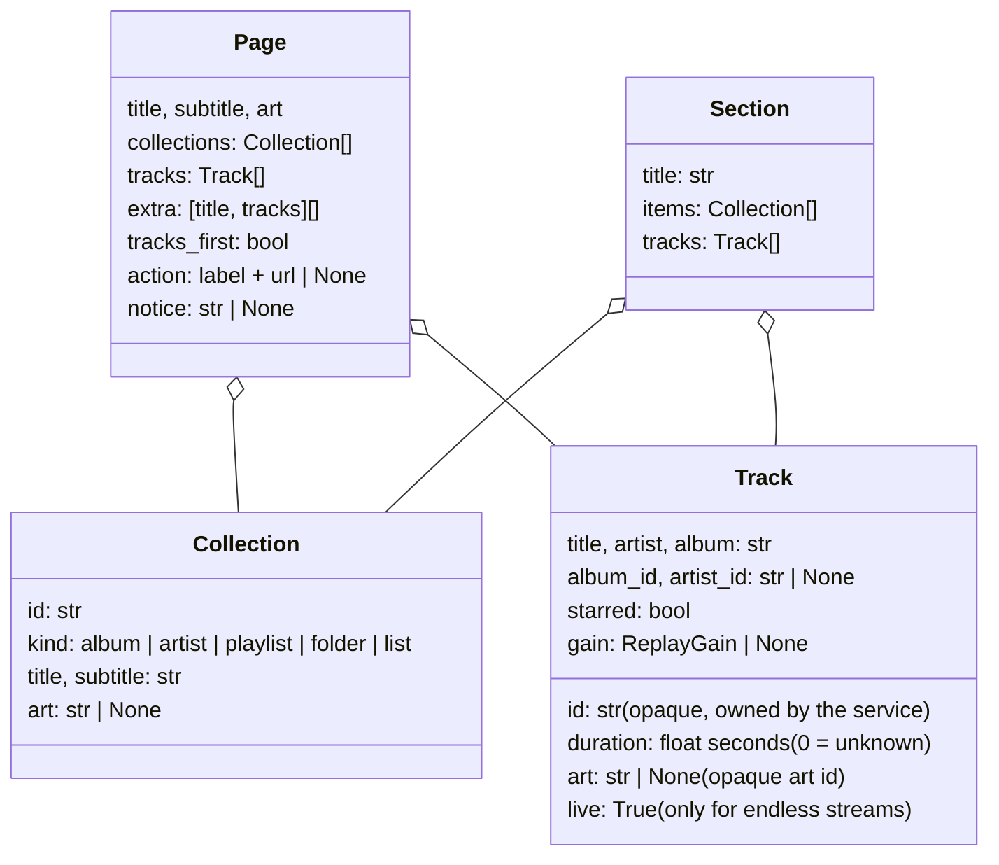
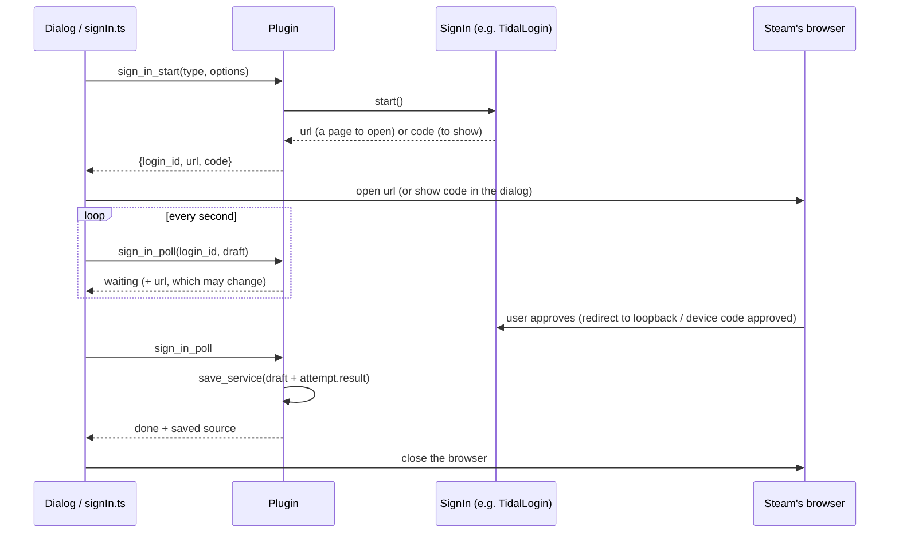

# MusicDeck architecture

This document explains how MusicDeck is put together, why it is built that way, and where to look
when you change something. It assumes you know roughly what [Decky Loader](https://decky.xyz) is: a
plugin system that injects JavaScript into Steam's UI and runs a Python backend per plugin.

- New to the code? Read **[Overview](#overview)** and **[Life of a play](#life-of-a-play)**, then
  skim the [module map](#module-map).
- Adding a music source? Go to [ADDING_A_SOURCE.md](ADDING_A_SOURCE.md).
- How each source talks to its service: [SOURCES.md](SOURCES.md).
- Building, testing, deploying to a Deck: [DEVELOPMENT.md](DEVELOPMENT.md).

## Overview

MusicDeck has two halves that talk over Decky's RPC bridge, plus two optional helper processes.

| Part | Runs in | Lifetime | Job |
| --- | --- | --- | --- |
| Frontend (`src/`) | Steam's shared JS context ("SharedJSContext") | While the plugin is loaded, independent of the QAM being open | UI, the audio player, EQ, queue, sleep timer |
| Backend (`main.py`, `py_modules/musicdeck/`) | Decky's plugin process (a frozen Python 3) | Plugin load → unload | Talks to services, stores settings, serves audio and art over loopback |
| yt-dlp worker | System Python (`/usr/bin/python3`) | Started on first YouTube stream | Runs yt-dlp, which needs stdlib modules Decky's Python lacks |
| Spotify helper | Native binary (`bin/<platform>/spotify-helper`) | Started on first Spotify request | Holds the librespot session; serves decrypted audio and Spotify's own catalogue reads |

### Why playback lives in Steam's browser engine

Audio plays in an `<audio>` element inside Steam's own JavaScript context. That context exists for
as long as Steam runs, so music keeps playing when the Quick Access Menu closes or a game starts,
and it gets Steam's audio output for free. The cost is that the browser engine can only fetch
things over HTTP with CORS, and it has no DRM support (no Widevine), which is why:

- every byte of audio goes through MusicDeck's **loopback stream server**, which adds CORS headers,
  hides credentials from URLs, and proxies byte ranges;
- sources whose catalogue is only available with DRM (Apple Music, Deezer, Amazon) can't be supported.

There are two `<audio>` elements ("decks"). One plays; about 15 seconds before its track ends, the
next track is loaded on the other, which takes over the moment the first ends (gapless, a few
milliseconds) or fades in over it (crossfade, equal-power curves on each deck's gain node). A
preloaded track is used only if it's still what comes next (same queue, same slot); skipping, seeking,
pausing or clearing during a fade ends the fade. Live streams, repeat-one and "stop after this track"
never preload.

## Life of a play

What happens when the user presses A on a track:

Details worth knowing:

- **Resolution is cached.** `StreamServer.resolve_stream` keeps each `StreamSource` until its
  `expires`, so seeking (new Range requests) doesn't ask the service again.
- **HLS** (SoundCloud, TIDAL DASH, some radio): the service returns a playlist URL, or builds the
  playlist itself (`StreamSource.playlist`). The server rewrites every URI in it to `/fetch?u=...`,
  so hls.js fetches segments through the server as well.
- **Failures recover once.** If playback errors or stalls, the player asks the backend to forget the
  cached source (`forget_stream`) and resolves it again, resuming at the same second. Only a second
  failure is reported and skipped. Live streams (radio) reconnect at the live edge instead.
- **Play reports** go to the source's own server (if it keeps play history and "Report plays" is on)
  and to ListenBrainz and Last.fm (if linked). A 90-second de-duplication window in `Plugin.scrobble` absorbs
  retries and reloads.

## Module map

### Backend (`main.py`, `py_modules/musicdeck/`)

| File | Responsibility |
| --- | --- |
| `main.py` | `Plugin`: every RPC endpoint the frontend calls (`browse` gives a source's genres, moods and charts). Owns settings, playlist store, stream server, service instances, the sign-in in progress, ListenBrainz and Last.fm. Endpoints return `{"ok": True, "data": ...}` or `{"ok": False, "error": "message for the user"}` via `_result`. Sources start and stop one at a time (`lifecycle` lock): two overlapping restarts would otherwise leave one instance running unstopped. |
| `musicdeck/models.py` | The one data model every service returns: Track, Collection, Page, Section. Plain dicts, mirrored by TypeScript types in `src/api.ts`. |
| `musicdeck/services/base.py` | `LocalLikes` (likes kept on the Deck for sources used signed out: the track saved in the config, marked liked wherever it shows by `Plugin._liked`, listed under Liked songs), `MusicService` (the interface every source implements), `StreamSource` (where audio/art comes from), `SignIn` (OAuth/device-code sign-ins), `ServiceError` (errors safe to show the user). `cached_tab` keeps a source's `SHARED_TABS` (charts, genres: nothing of the user's) for ten minutes, so a refresh after an edit doesn't fetch them again. |
| `musicdeck/services/__init__.py` | `CATALOGUE` and `SERVICE_TYPES`: every source type, in "Add a source" order; a type's module is imported the first time it's needed. |
| `musicdeck/tagging.py` | Writing tags: the editor's fields as each format's keys (EasyID3, Vorbis comments, EasyMP4 with composer and label registered, raw ID3 frames in WAV/AIFF), to a copy that replaces the file; returns what changed keys held, for undo. |
| `musicdeck/watch.py` | `FolderWatcher`: inotify through ctypes on every folder under the local source's roots, reporting a change once they've been quiet a while (new albums being copied in). Unavailable elsewhere: the periodic scan covers it. |
| `musicdeck/slsk.py` | A Soulseek client in pure Python: sign-in, search, peer connections direct or through the server, downloads that resume, whole folders, browsing users, and opt-in sharing (`Shares`; answering searches from the server and a distributed parent, browses, folder requests; uploads in 2 slots); peers' messages bounded and parsed defensively. |
| `musicdeck/igd.py` | UPnP port forwarding on the home router (SSDP, the gateway's WANIPConnection, AddPortMapping renewed hourly), for Soulseek's port. |
| `musicdeck/catalogues.py` | Apple's (iTunes Search API) and Deezer's public catalogues: album searches, albums in MusicBrainz's release shape, and covers, for the local source's look-ups and artwork. |
| `musicdeck/pictures.py` | Artists' pictures from Deezer's public catalogue API (exact name match), and the whole-file picture download it shares with `musicbrainz.py`. |
| `musicdeck/musicbrainz.py` | MusicBrainz (release search and details, one request a second, a User-Agent naming the app) and the Cover Art Archive (front covers), for the local source's look-ups and artwork. |
| `musicdeck/background.py` | `spawn()`: work nothing awaits (play reports, a re-read after a change), held until done (asyncio only keeps a weak reference) with its failure logged; `cancel_all()` at unload, so nothing outlives the plugin. |
| `musicdeck/version.py` | The version from `package.json` (`current()` reads it fresh, so a frontend-only update shows its own), and the User-Agent built from it. |
| `musicdeck/net.py`, `musicdeck/cache.py` | The one TLS context every HTTPS connection shares (certifi's bundle costs ~1 MB per context), and the bounded, expiring cache every in-memory cache uses. |
| `musicdeck/services/*.py` | One file per source. See [SOURCES.md](SOURCES.md). |
| `musicdeck/server.py` | `StreamServer`: loopback HTTP server for `/stream`, `/art`, `/fetch`; downloaded files first, then range proxying, HLS rewriting, resolved-source cache. While casting, a second site on the home network (`open_lan`) serves the one device being cast to: a fresh random link per track, only that device's address answered, HLS pieces only from that track's own hosts. |
| `musicdeck/cast/` | Casting. `mdns.py` (one-shot mDNS browse) and `upnp.py` (SSDP search) find devices; `castv2.py` is a Google Cast sender (hand-encoded protobuf over TLS, the Default Media Receiver); `upnp.py` drives UPnP AVTransport/RenderingControl renderers by SOAP, polled once a second, with each renderer's own names for formats. `CastManager` (`__init__.py`) connects, loads tracks from the network site and passes the device's state on as `cast_status` events. Services can offer a `compatible_stream` (YouTube: AAC; Qobuz: CD quality) and opt out with `castable = False` (Spotify). |
| `musicdeck/settings.py` | `Settings`: atomic JSON store for preferences and configured sources (credentials included, so `chmod 600`). |
| `musicdeck/recents.py` | `Recents`: the albums and playlists played lately per source, for the "Jump back in" row (`played_collection`; recorded by `playFrom` in nav.ts), and recent searches (recorded by `search`; `search_history`, `forget_search`). |
| `musicdeck/playlists.py` | `PlaylistStore`: MusicDeck's own playlists (`md:` ids) with custom artwork (`mdart:` ids), stored on the Deck, and which are downloaded. |
| `musicdeck/backup.py` | Backup files: building one (no `SECRET_KEYS`, ever) and checking one before `Plugin.import_backup` adds what's missing (known types, 12-hex ids, image types, MusicDeck's own data-file names only). Restored sources that had a sign-in are marked `sign_in_again` until edited. |
| `musicdeck/offline.py` | `OfflineStore`: downloads for the playlists marked for it, one track at a time in the background, kept once per (source, track) with their artwork. Files come in 8 MB ranges; HLS is joined into one file (fragmented MP4, or MP3/AAC segments; never encrypted or MPEG-TS). Stops early with no space (1 GB kept free) or after 3 failures in a row. A track un-marked while it downloads isn't kept, and one marked as the downloader finishes gets another pass (`asked_again`). The stream server serves these files before going to the network. |
| `musicdeck/lyrics.py` | The lyrics shape, LRC parsing, the lyrics sites asked when a source has none: LRCLIB and NetEase at once, LRCLIB's synced lyrics preferred (a failed lookup is an error, not "no lyrics"). |
| `musicdeck/feeds.py` | A small XML reader and the RSS parser for podcast feeds (Decky's Python has no `xml`). |
| `musicdeck/listenbrainz.py` | ListenBrainz client with an on-disk queue for listens made offline. |
| `musicdeck/lastfm.py` | Last.fm client: signed calls (`sign`), the desktop sign-in (token, approval on Last.fm's page, session key), now playing and scrobbles in batches of 50, with an on-disk queue like ListenBrainz's. The user's own API key and secret; a revoked session unlinks. |
| `musicdeck/audio_output.py` | The output sound plays on (speakers, headphones, a Bluetooth device, HDMI), followed through `pactl subscribe` and read from the default sink's active port (Steam sees the speakers and the headphone jack as one device). With `eq_per_output`, `main.py` keeps an EQ per output in `output_eqs` and `get_state` hands out the one for the output in use; `set_eq` saves to the output an EQ was set on. |
| `musicdeck/debuglog.py` | Optional verbose log (`musicdeck-debug.log`), toggled in settings; the player's events land here too. |
| `musicdeck/ytdlp_worker.py` | Runs under the system Python; answers yt-dlp and YouTube Music (ytmusicapi) requests as JSON lines. Started on demand, stopped after 5 idle minutes. |
| `musicdeck/ytdlp_update.py` | Keeps yt-dlp current from PyPI (checksum-verified, rolled back if the new version fails). |
| `musicdeck/devices.py` | `DeviceWatcher`: music players, iPods, sticks (USB storage mounted under `/run/media/<user>/`) and phones (MTP through GVfs, mounted with `gio`) plugged in, every 3 s; `Plugin._devices_changed` makes each a `DeviceService` source while it's there (not saved), and hands the live source back when the live one is unplugged. |
| `musicdeck/native.py` | The platform (`linux-x86_64`, `linux-arm64`, `windows-x86_64`...) and its helpers in `bin/<platform>/` (`helper()`; Windows on Arm falls back to the x86_64 builds), and `NO_WINDOW`: every helper process starts without a console window on Windows. Decky's Python is the same on every platform (Decky 3.3 freezes 3.14 with the same standard library for Linux x86_64 and arm64 and Windows); what differs is handled where it's used: the yt-dlp worker's Python (on Windows the embeddable Python shipped in `bin/windows-x86_64/python/`, which ignores `PYTHONPATH`, so the worker adds `MUSICDECK_PATH` to `sys.path` itself; then `py -3` or `python`, never the Microsoft Store's stand-in), Steam's folder (the registry on Windows), tag edits replacing a file Windows has open (retried). PipeWire's output detection and inotify are simply unavailable there. |
| `backend/spotify-helper/` | Rust crate for the Spotify helper (librespot). `main.rs`: control protocol and audio server; `reads.rs`: catalogue reads over Spotify's own client API. |

### Frontend (`src/`)

| File | Responsibility |
| --- | --- |
| `index.tsx` | Plugin entry: loads state, restores the session, installs the QAM patch, exposes the `window.__musicdeck` debug handle, cleans up on unload. |
| `api.ts` | Typed wrappers for every backend endpoint (`callable(...)`) and the shared types. |
| `store.ts` | `Store<T>` (tiny observable used with `useSyncExternalStore`), `pluginState`, `mediaUrl()` for stream/art URLs. |
| `player.ts` | `Player`: queue, shuffle/repeat, the two audio decks and Web Audio graph, gapless and crossfade, HLS, recovery, play reports, session persistence, radio extension. While casting (`castTo`/`stopCasting`) the playing deck is the device, so everything above works unchanged. A `Deck` makes its `<audio>` element when it's first needed (`build()`) and lets go of it entirely (`release()`: listeners, source, element) when the queue is cleared, the player is destroyed, or playback has been paused for 10 minutes; play picks up at the place it held. A destroyed player (the copy an unloaded plugin leaves behind) ignores everything. The analyser after the EQ feeds the visualizers (`levels()`, read over -85 to -10 dB so music's low end doesn't sit at full). |
| `cast.ts` | `RemoteAudio`: stands in for an `<audio>` element while casting, forwarding to the backend and turning the device's reports into element events. Reports that contradict a command just sent are ignored until the device catches up (slow, polled UPnP renderers). `watchCastStatus()` (called at load, undone at unload) listens for the device's reports. |
| `qam.tsx` | Takes over the Quick Access Menu's Soundtracks tab (or adds a tab) by wrapping Decky's `__TABS_HOOK_INSTANCE.render`. |
| `nav.ts` | Panel navigation (Library/Search stacks), kept outside React so it survives the QAM closing. |
| `sources.ts` | Switching or deleting the live source; `followState` stops playback and clears the queue whenever the live source changes, whoever changed it. |
| `signIn.ts` | The browser sign-in flow shared by Qobuz, Spotify and TIDAL; `browseThenReturn` for opening a page and coming back. |
| `sleep.ts` | Sleep timer. |
| `steam.ts` | What only Steam's UI knows, for the Steam soundtracks source: owned soundtracks, their games and art, the running game. |
| `games.ts` | Games starting and stopping: plays the music set for a game (`set_game_music`) and pauses it when the game closes; with "In games" set to Pause (`playback.game_pause`), pauses the music during games and resumes it after; set to lower it (`playback.game_duck`, the share of the volume kept), lowers it while gamescope says a game is in front (`RegisterForFocusChangeEvents`; Steam itself is 769) through the player's ducking gain, the last stage of its graph; keeps the Steam source's running game current. Each undoes only what it did itself. Steam's running list decides what started or stopped (its notifications' process ids don't pair a start with its stop). |
| `eq.ts`, `log.ts`, `notify.tsx` | EQ bands and presets; batched debug logging to the backend; Steam toasts with artwork (see [Toasts](#toasts)). |
| `components/MusicPanel.tsx` | The QAM panel: a tab strip on top (Now playing, Library, Search, Settings: the equalizer, `PlaybackSections` and `CenterChoices`, as the media center's Settings); Now playing is `PlayerPages`, the others a one-row mini player (`NowPlaying.tsx`) above their content. |
| `components/PlayerPages.tsx` | Now playing as two pages in a frame exactly as tall as the panel (`overflow: clip`; the panel itself never scrolls): the tabs and the player, then the lyrics (when there are none, the visualizer's record: the cover turning, the music as spokes round it in the cover's colour) or the queue under a quiet header. Focus moving between them slides the frame a whole page. The cover gives up what the player would overrun its page by (`useCoverThatFits`, 76 down to 44 px). |
| `components/Browser.tsx` | Library and search views: home sections, collection pages, result caching. |
| `components/NowPlaying.tsx` | Now playing card, seek bar (or LIVE bar), transport, volume. |
| `components/LyricsView.tsx` | The lyrics under Now playing, and what the full-screen page shares with it: `useLyrics` (looked up once per track; a failed lookup isn't remembered) and `SyncedLyrics`. |
| `components/media/` | The media center, a route in Steam's main window (`/musicdeck/player`, added in index.tsx) built on Steam's `Tabs`: `MediaCenter.tsx` (tabs: Now Playing, the source's Home, Browse (`BrowseIndex`: a tile for each of the source's other `center_tabs` in its group (yours, listening as "For you", explore, genres, files), its line and covers from the source or, a moment later, `browse_info` (`MusicService.browse_info`: each tab fetched for its tile by `tab_info`, kept ten minutes, and kept two for opening it); opened as `section` views in Browse's history; one section is shown directly), Search, Settings; the now-playing bar, screen off; its choices are the `center` setting), `nowplaying.tsx` (Now Playing's panels by the source's `NOW_PLAYING` kind: lyrics and queue (and Info for `library`, local files), on air and station, notes and episodes, chapters, setlist; R2 goes through them; `details()` fills the notes, facts and related tracks; the visualizer, bars here and a turning record in the panel), `pages.tsx` (a source tab's page (`center_tab`), its sections shown as each asks: shelves, a row of music per genre or mood, tiles, a grid of every card, covers; collection pages, Search, the queue list; each source's tabs keep their own histories in `centerNav`, "<source>/<tab>"), `parts.tsx` (capsule cards, shelves, the card and tile grids, the track table, focus restoring, and `snapRows`: every page and the Now Playing queue scroll by whole rows and lines in an eased glide of their own instead of Steam's, a browsing page's rows on one height so the screen holds whole rows; `FittedGrid`, every grid, its shape from `grid.ts`'s `gridShape`: columns from the width, the covers filling it, as many whole rows as fit under the title, sliding in a row at a time). It reuses the panel's data loading and actions from `Browser.tsx`. |
| `components/CastMenu.tsx` | "Play on": this Deck or a device found on the network, opened with X on a volume slider. |
| `components/Queue.tsx` | The queue in play order, with moving tracks (menu items, or "Move…" mode on the d-pad; see `RowMoving` in common.tsx). |
| Library buttons | An album's, artist's or playlist's page from a source with `SAVES` carries `save` (whether it's in the user's library on the service). `useLibrarySave` (Browser.tsx) gives both headers, the panel's and the media center's, one toggle: Add to library / In library, Follow / Following, or Add to favourites / In favourites on servers. It shows the change at once, calls `save_to_library`, and takes it back if the service refuses. |
| `components/TrackMenu.tsx` | Context menus for tracks and collections (queue, favourites, playlists (new ones on the service when it keeps them), sleep timer, go to, tags and artwork for local files). |
| `components/TagEditor.tsx` | Managing local files: the tag editor (a track, or an album's shared fields; undo), the MusicBrainz release picker and its preview of changes, album artwork (set, find, back to the files'). An album renamed keeps its open pages (`retargetAlbum`). |
| `components/Settings.tsx` | The plugin's page in the Decky menu: sources, then `PlaybackSections` (playback, scrobbling with ListenBrainz and Last.fm, games; the media center's Settings shows the same component), downloads, troubleshooting. |
| `components/ServiceModal.tsx` | Add/edit dialog for a source, with a fields component per source type. |
| `components/common.tsx` | Shared rows, artwork, dialog footer, and `ScrollingText`: a line that ends in "…" and scrolls (Steam's marquee) while its row is focused, or always in headers and the now-playing card. |

## Data model

Every service returns the same shapes (`models.py`; TypeScript in `src/api.ts`), so the UI never
needs to know which source it is showing.

- **Ids are opaque.** A Spotify track id, a file path, a Bandcamp URL: only the service that issued
  an id interprets it. The frontend sends it back as-is.
- **Art ids are opaque too.** The UI turns them into `/art/{instance}/{art id}` URLs; the service's
  `art()` decides where the bytes come from. MusicDeck's own playlist artwork uses `mdart:` ids,
  which the server answers without asking a service.
- `kind: "list"` collections are service-defined lists ("Favourite tracks", "Genres"); `open()`
  receives the kind and id and returns a Page.
- A Page can carry an **action** (a header button: `steam://` URLs run in Steam, like installing a
  soundtrack; other URLs open in Steam's browser) and a **notice** (a sentence explaining why
  there's nothing to play yet).

## Storage

| Where | File | Contents |
| --- | --- | --- |
| `~/homebrew/settings/MusicDeck/` | `settings.json` (mode 600) | Preferences, configured sources and their credentials (tokens, never passwords), ListenBrainz token, Last.fm API account and session key, game music |
| | `playlists.json`, `playlist-art/` | MusicDeck playlists and their custom pictures |
| `~/homebrew/data/MusicDeck/` | `session.json` | The queue, for "Resume where you left off" |
| `~/homebrew/data/MusicDeck/` | `offline/` | Downloaded songs and their artwork (named by a hash of source and id) and `index.json`, which maps them back (file names, types and sizes only) |
| `~/homebrew/data/MusicDeck/` | `recents.json` | The last 10 albums and playlists played and the last 8 searches, per source |
| | `local-<id>.json`, `local-<id>-favourites.json`, `local-<id>-plays.json`, `local-<id>-tag-history.json`, `local-<id>-review.json`, `local-<id>-lyrics/`, `local-<id>-art/`, `art-cache/` | Local library index (tags, quality, when each file was added), favourites, play counts and when each track was last played, each file's last tag edit (to undo it), new albums to review, lyrics kept by MusicDeck, albums' own pictures (set or found), extracted cover art |
| | `steam-<id>.json`, `steam-<id>-owned.json`, `steam-<id>-favourites.json` | Installed soundtracks index, owned soundtracks (from Steam's UI), favourites |
| | `podcasts-<id>-progress.json` | Where each podcast episode was left, and which are played |
| | `qobuz-app.json`, `soundcloud-client.json` | Public app credentials scraped from the services' web players (refreshed when rejected) |
| | `spotify/accounts/<username>/` | librespot's reusable credentials, one folder per account |
| | `yt-dlp-cache/`, `ytdlp-update/` | yt-dlp's cache and self-updated copies |
| | `listenbrainz-pending.json`, `lastfm-pending.json` | Listens waiting to be sent |
| `~/homebrew/logs/MusicDeck/` | `musicdeck-debug.log` | Only when "Debug log" is on |

The frontend never receives secrets: `Plugin._public_service` removes every key named in
`SECRET_KEYS` and reports `has_credentials` instead.

Files named after an instance (`<type>-<id>…`, an account's folder) belong to that source and are
deleted when it is removed (`MusicService.remove`, called by `Plugin.remove_service`).

### Several accounts

Sources are instances, so a type can be configured any number of times; each instance has its own
config, files and running state. `MusicService.account(config)` names the account an instance is
signed in to, and `Plugin.save_service` refuses a second instance of a type for the same account.
Anything a service stores on disk for an account must be keyed by instance or account, never shared
across a type (shared files are fine for public data, such as the app credentials Qobuz and
SoundCloud scrape from their web players).

## Security model

- The stream server listens on **127.0.0.1 only**, on a random port, and requires a per-session
  random key (`?k=`) on every request. Other users or devices on the network can't reach it, and
  other local programs can't guess the key.
- Service credentials stay in the backend. Where a service needs a token on audio or art requests
  (Jellyfin, Emby, Plex, Audiobookshelf, Subsonic), it is added by the server when proxying, not put into
  URLs the UI sees.
- Passwords are never stored. Navidrome passwords become Subsonic salted tokens and Jellyfin,
  Emby and Audiobookshelf passwords become access tokens on save; Plex signs in with a plex.tv code; Qobuz, TIDAL and
  Spotify sign in on their own websites.
- No source that works without an account asks for one (SoundCloud, YouTube, Bandcamp, radio).
- The Spotify helper's loopback audio server requires its own per-start key (a header the stream
  server adds), so nothing else on the device can play through the account.
- Logs and error messages are redacted (`debuglog.redact`): no web address keeps its query, no
  credential-looking value survives. MusicDeck's settings, data and log folders are made 0700.

Threat model, every entry point and its guard, the audit's findings and the remaining risk:
[SECURITY.md](SECURITY.md).

## Sign-in

Sources with a username/password form (Navidrome, Jellyfin, Emby) exchange it in `authenticate()` when
the dialog is saved. Sources whose sign-in happens elsewhere implement `MusicService.sign_in()`,
returning a `SignIn` that every flow drives the same way:

## Quick Access Menu integration

Decky already patches Steam's QAM renderer and, on every render, calls
`window.__TABS_HOOK_INSTANCE.render(tabs, visible)` with Steam's tab array. `qam.tsx` wraps that
method and, in the array, swaps the Soundtracks tab's panel and title for MusicDeck's (or appends
its own tab). If Decky ever stops exposing the hook, the patch disables itself and MusicDeck stays
usable from the Decky menu.

Reloads and updates need care, because Steam only rebuilds the tab array when the menu renders.
After a reload with the menu open, the tab still holds the previous copy's element, and that copy's
React tree keeps running with stores nothing updates any more. So the tab never holds the panel
itself: it holds a `PanelHost`, which draws whatever panel is in `window.__musicdeckPanel`, a small
registry every loaded copy shares. Each copy puts its panel there on load, so an old host switches to
the new panel at once. The newest copy also owns the patching (`window.__musicdeckQamOwner`);
wrappers left by older copies pass straight through.

The Decky menu has the same problem the other way round: it keeps showing the plugin page from
before a reload, and that page's buttons talk to the unloaded copy. So the backend emits
`state_changed` after every change to sources or settings (`_announce_change` in `main.py`), and
each copy reloads the state when it hears it. Resetting playback on a source switch happens in
`followState` (`sources.ts`), which watches the state, so it runs in the copy that's playing
whichever page made the change.

## Toasts

Decky's toaster can't draw a picture on current SteamOS: its renderer doesn't apply there (Decky
toasts reach Steam components that fail on them), so Steam, or a plugin such as Steamcord that
reroutes every Decky toast, draws them in Steam's chat-message style with a "?" avatar. `notify.tsx`
uses that style itself, as Steamcord does for Discord avatars:

- Each toast is a `DisplayClientNotification` friend message "from" a stand-in persona: an account
  id in `0xDD000000`–`0xDD00FFFF` (no real account; Steamcord uses `0xDE…`), hashed from the
  title and artwork. Its `friendStore` entry gets the title as its name (set again for a few
  seconds, since Steam refreshes unknown accounts and wipes it) and the artwork as its avatar
  (`avatar_url_*` getters). The artwork is MusicDeck's own `/art` URL; without one, an inline SVG.
- Two hooks, in Steam's notification sound (on the store's prototype and on any wrapper already
  there) and in its open-a-friend-chat action: ours play the ordinary toast sound instead of the
  chat ping, and tapping ours opens MusicDeck. Everything else passes through. They stay for the
  Steam session and act through `window.__musicdeckToastHooks`, which the newest plugin copy fills
  and an unloading copy empties; a change to the hooks themselves raises `HOOKS_VERSION`.
- Once shown, the toast is removed from Steam's notification list (`RemoveGroupFromTray`).
- They follow Steam's own notification settings for friend messages: turning those off hides them.

## Resources

MusicDeck is meant to cost nothing noticeable while a game runs. Measured on a Deck (Bazzite,
October 2026) with seven sources set up:

| What | Cost | How it's kept there |
| --- | --- | --- |
| Backend, idle | 28 MB (PSS), ~0% CPU | Source modules load only for types in use; one shared TLS context; bounded caches |
| Backend, streaming | +0.05% of one core | Bytes are relayed as they arrive, never decoded or re-encoded |
| Steam UI, playing, menu closed | 0.13% of one core (the same as paused) | No timers while hidden; audio decodes in Chromium's audio thread |
| Steam UI, menu open on MusicDeck | 2–3% of one core | Position updates only redraw the now-playing card |
| YouTube worker | ~80 MB while YouTube is in use, 0 otherwise | Stops after 5 idle minutes |
| On disk | ~31 MB (8 MB download), of which yt-dlp is 16 MB | |

For comparison, the hidden-browser route to Apple Music measured 313 MB on disk and ~300 MB of
memory idle (see SOURCES.md). To measure again: the backend's `/proc/<pid>/smaps_rollup` (PSS),
and CDP's `Performance.getMetrics` (`ScriptDuration`, `TaskDuration`) on `SharedJSContext` and
`QuickAccess` over a fixed window.

## Constraints that shaped the code

- **Decky's Python is frozen and incomplete.** Modules such as `xml`, `html`, `webbrowser` and
  `getpass` are missing; importing one at the top of a module stops the whole plugin loading. The
  backend test suite fails if any MusicDeck module does that. yt-dlp needs several of them, so it
  runs in a worker on the system Python.
- **No DRM in Steam's browser engine.** Only sources with unencrypted streams can be played; the
  Spotify helper decrypts with librespot, the open-source client engine for Spotify Premium accounts.
- **Signed URLs expire.** Services set `StreamSource.expires`; the server re-resolves on expiry or a
  403, and the player recovers once.
- **Rate limits.** Spotify's public Web API app is shared and rate-limited; most Spotify reads go
  through the helper's librespot session instead, and users can add their own developer app.
